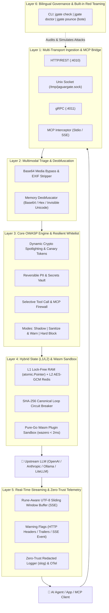

# 🐆 JaguarGate (`jgate`)

> **Ultra-low latency AI, Autonomous Agent & MCP Security Gateway in Go.**  
> *Named after Panthera onca (the Brazilian Jaguar — from Tupi "Yaguara", the predator that neutralizes threats in a single leap).*

[](https://go.dev/)
[](LICENSE)
[](https://owasp.org/www-project-top-10-for-large-language-model-applications/)
[](README_pt-BR.md)

🌍 **Read in other languages:** [Português (Brasil) 🇧🇷](README_pt-BR.md)

---

## ⚡ Why JaguarGate?

Traditional security proxies treat AI traffic like static web pages: if a single parameter violates a rule, they return an `HTTP 403/500`, **crashing your autonomous agent's entire reasoning loop** and wasting tokens.

**JaguarGate** is a resilient, sub-millisecond sidecar gateway built in pure Go (`CGO_ENABLED=0`) designed for **LLMs**, **Autonomous Agents** (AgentScope, LangChain, CrewAI, LiteLLM), and **MCP (Model Context Protocol)** servers:

* 🛡️ **Graceful Degradation (Selective Pass-Through):** If an agent calls 3 tools in parallel and 1 is unauthorized, JaguarGate surgically prunes only the unauthorized tool call, keeps the request alive (`HTTP 200`), and attaches lightweight **Warning Flags** (`X-JaguarGate-*`).
* 🚀 **Tri-Transport Architecture:** Standard **HTTP/REST** (`:4010`) for zero-code integration, **Unix Domain Sockets (UDS)** for near-zero kernel-level latency with local models (e.g., Ollama), and **gRPC** for high-throughput microservices.
* 🌊 **Rune-Aware Streaming Inspection (SSE):** Validates token-by-token responses in real time using a UTF-8 safe sliding window buffer without delaying Time-To-First-Token (TTFT).
* 🔐 **Reversible PII & Secrets Vault:** Masks sensitive data (CPF, CNPJ, Credit Cards, API Keys) with safe pseudonyms before leaving your infrastructure and restores them on the way back if authorized.
* 🔌 **MCP Guardrail & Wasm Extensibility:** Protects local (`stdio`) and remote (`HTTP/SSE`) MCP servers and supports sandboxed **WebAssembly (`wazero`)** community plugins.

---

## 🏗️ 6-Layer Architectural Pipeline



---

## 🚀 3-Line Quickstart (Zero-Code Configuration)

Beginners don't need to write complex regex rules. A complete `jaguargate.yaml` requires only **3 lines**:

```yaml
core:
  version: "1.0"
  language: "en"         # "en" or "pt-BR"
  preset: "balanced"     # "permissive" (learning) | "balanced" (recommended) | "strict" (maximum armor)
```

Point your SDK or agent's `BASE_URL` to `http://localhost:4010/v1` and start JaguarGate:

```bash
# Validate configuration syntax
jgate check

# Run built-in diagnostic and simulated OWASP attack battery ("The Jaguar's Pounce")
jgate pounce

# Start the gateway
jgate start -c configs/jaguargate.yaml
```

---

## 🌐 Language Configuration (`en` Default | `pt-BR`)

**[EN]** By default, JaguarGate outputs all CLI tables (`jgate doctor`, `jgate pounce`, `jgate check`) and operational logs in **English (`en`)** to maintain clean, single-language parsing in CI/CD pipelines and SIEM platforms. Users can switch the entire interface to **Portuguese (`pt-BR`)** via any of the three methods below:

1. **CLI Flag (Per-Command Override):**
   ```bash
   ./jgate doctor --lang pt-BR
   ./jgate pounce --lang pt-BR
   ```
2. **Environment Variable (Docker / Kubernetes / CI):**
   ```bash
   export JAGUARGATE_LANG="pt-BR"
   ./jgate serve -c jaguargate.yaml
   ```
3. **Configuration File (`jaguargate.yaml`):**
   ```yaml
   core:
     version: "1.0"
     preset: "balanced"
     language: "pt-BR" # Default: "en"
   ```

---

## 📊 OWASP LLM & Agentic Top 10 Coverage

| OWASP Threat | JaguarGate Defense Mechanism | Default Behavior (`sanitize_and_warn`) |
| :--- | :--- | :--- |
| **LLM01: Prompt Injection** | Base64/Hex deobfuscation + Dynamic Cryptographic Spotlighting tags | Neutralizes injection payload; forwards clean context + `JG-SEC-401` |
| **LLM02: Sensitive Info Disclosure** | Reversible PII & Secrets Vault (in-memory or AES-GCM Redis) | Replaces secret with `<JG_PII_TOKEN>` + `JG-PII-301` |
| **LLM05: Improper Output Handling** | Markdown image tracker blocker & script sanitizer | Strips malicious links in real-time SSE stream + `JG-SEC-502` |
| **LLM06: Excessive Agency** | Selective Tool Call & MCP Whitelist Firewall | Prunes unauthorized tool calls without crashing HTTP 200 + `JG-CFG-101` |
| **LLM07: System Prompt Leakage** | Invisible Canary Token injection & sliding-window detector | Immediately truncates leaked stream + `JG-SEC-501` |
| **LLM10: Unbounded Consumption** | Canonical SHA-256 Agent Loop Circuit Breaker & token caps | Halts repetitive identical tool loops gracefully + `JG-CFG-201` |

---

## 🗺️ Project Roadmap & Milestones

- [x] **Milestone 0 (`v0.1.0-spec`):** Configuration Contract (`YAML`/`JSON`), Compact Warning Flag Taxonomy (`JG-*`) & Bilingual Catalog (`EN`/`PT-BR`).
- [ ] **Milestone 1 (`v0.2.0-core`):** Lock-Free Config Engine (`atomic.Pointer`), Buffer Recycling (`sync.Pool`), Zero-Trust Redacted Logger & Base Proxy (HTTP + UDS).
- [ ] **Milestone 2 (`v0.4.0-input-guards`):** Pre-compiled RE2 Engine, Deobfuscator, Multimodal EXIF Hygiene, Dynamic Spotlighting & Local PII Vault.
- [ ] **Milestone 3 (`v0.6.0-streaming-tools`):** Rune-Aware UTF-8 Sliding Window SSE Inspector, Selective Tool Call Firewall & HTTP Trailers/SSE Warnings.
- [ ] **Milestone 4 (`v0.8.0-scale-mcp`):** Distributed L1/L2 State (Redis/Valkey AES-GCM), SHA-256 Loop Breaker, gRPC Transport & MCP Guardrail.
- [ ] **Milestone 5 (`v1.0.0-release`):** Pure-Go Wasm Sandbox (`wazero`), OpenTelemetry Exporter, Rate-Limited Webhooks & CLI (`jgate doctor` / `jgate pounce`).

---

## 📄 License

Distributed under the **Apache License 2.0**. See [`LICENSE`](LICENSE) for more information.
