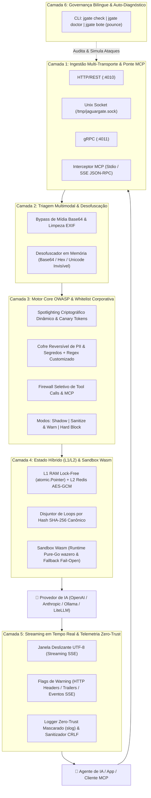

# 🐆 JaguarGate (`jgate` / `onca`)

> **Gateway de Segurança de Ultra-Baixa Latência para IA, Agentes Autônomos e MCP em Go.**  
> *Batizado em homenagem à Panthera onca (a nossa onça-pintada — do Tupi "Yaguara", o predador que neutraliza a ameaça em um único salto).*

[](https://go.dev/)
[](LICENSE)
[](https://owasp.org/www-project-top-10-for-large-language-model-applications/)
[](README.md)

🌍 **Leia em outros idiomas:** [English 🇺🇸](README.md)

---

## ⚡ Por que o JaguarGate?

O **JaguarGate** é um **gateway corporativo agnóstico de framework para políticas de tráfego LLM e MCP** escrito em Go puro (`CGO_ENABLED=0`), desenhado como camada de rede/sidecar **complementar aos guardrails de aplicação** (como Pydantic AI, LangChain, CrewAI ou hooks de SDK — *Defense-in-Depth*):

> **Fronteira Arquitetural:** Regras de negócio (RBAC do usuário logado, limites de pagamento, aprovação humana) pertencem ao executor da aplicação. O **JaguarGate** aplica políticas unificadas de tráfego em toda a infraestrutura (Python, Go, Node.js, Ruby, Java), impedindo que dados sensíveis saiam do perímetro rumo a provedores LLM externos.

* 🛡️ **Degradação Elegante & Feedback Semântico de Veto:** Se um agente emitir 3 ferramentas em paralelo e 1 não estiver autorizada, o JaguarGate remove cirurgicamente apenas a chamada proibida, mantém o transporte vivo (`HTTP 200`) e emite cabeçalhos/trailers estruturados de veto (`X-JaguarGate-Veto: tool_unauthorized`, `X-JaguarGate-Pruned-Tools`, `X-JaguarGate-Codes`).
* 🧩 **Regras Corporativas e Dados Brasileiros Nativos:** Detectores integrados para **CPF** (formatado e cru de 11 dígitos com validação Módulo 11), **CNPJ** (numérico e alfanumérico 2026), **Telefone Brasileiro** (celular e fixo com DDD), **Cartões de Crédito** (13–19 dígitos com validação Luhn), **Email**, **Chaves AWS**, **API Secrets**, **JWT** e **Cabeçalhos de Chave Privada**, além de `pattern_overrides` e `custom_patterns` via YAML/JSON.
* 🚀 **Arquitetura Tri-Transporte:** **HTTP/REST** (`:4010`) para integração sem alterar código, **Unix Domain Sockets (UDS)** para roteamento local via Kernel (ex: Ollama) e **gRPC/RPC** (`:4011`) com validação Bearer e framing `Grpc-Status: 16 (UNAUTHENTICATED)`.
* 🌊 **Inspeção Incremental de Streaming (SSE / NDJSON):** Remonta argumentos de ferramentas divididos em chunks e inspeciona fluxos OpenAI, Anthropic e Ollama por meio de uma **janela deslizante UTF-8 de 64 runes** (sobretaxa determinística inferior a 100µs por fragmento, sem buffering do corpo inteiro; a retenção de sufixo ativa-se apenas quando um marcador aberto, canário ou prefixo de segredo é detectado).
* 🔐 **Cofre Reversível PII com Retenção Estrita de Segredos (`restore_secrets: false`):** Mascara PII e segredos com pseudônimos de 128 bits vinculados à sessão (`<JG_PII_{LABEL}_{HEX}>`), preservando o metadado `isSecret` na memória L1 e no Redis L2. Por padrão, **PII autorizada é restaurada para a sessão dona enquanto segredos permanecem retidos mesmo se ecoados pelo modelo**, somado ao **DLP Ativo de Saída (`JG-SEC-503`)** contra credenciais geradas espontaneamente pelo LLM.
* 🔏 **Logger Zero-Trust Extensível:** Reduz dados sensíveis e credenciais dos logs da aplicação com motor thread-safe linear (`slog`) e sanitização nativa contra injeção CRLF (CWE-117 / GoSec G706).
* 🔌 **Guardrail MCP & Firewall Recursivo:** Inspeciona recursivamente chamadas JSON-RPC 2.0 (`tools/call`, `resources/read`) com teto de profundidade (`JG-CFG-203`), corpo de erro seguro em bloqueios em lote (HTTP 403) e cobertura de campos irmãos.
* 🔄 **Disjuntor de Loops por Hash Canônico SHA-256:** Interrompe loops infinitos de agentes em tempo $O(1)$ identificando a assinatura canônica das chamadas repetidas (`tool_name + sorted_json_args`).

---

## 🏗️ Pipeline Arquitetural em 6 Camadas



---

## 💻 Comandos da CLI & Como Usar

O JaguarGate inclui uma CLI bilíngue unificada (`jgate`), desenhada tanto para desenvolvedores quanto para automação de CI/CD:

| Comando | Sinônimo (Alias) | Objetivo |
| :--- | :--- | :--- |
| `jgate check` | — | Valida a sintaxe, schemas e invariantes do arquivo `jaguargate.yaml`. |
| `jgate doctor` | — | Diagnostica portas de rede, upstream, permissões de socket e conexão Redis. |
| `jgate bote` | `jgate pounce` | Executa a bateria de ataques Red-Team OWASP Top 10 ($< 2.5\text{ms}$ de execução). |
| `jgate serve` | `jgate start` | Inicia o gateway multi-transporte com hot-reload atômico e telemetria Zero-Trust. |

### Inicializando o Gateway

```bash
# 1. Validar a sintaxe do arquivo de configuração
jgate check -c configs/jaguargate.yaml

# 2. Executar a auditoria de segurança e simulação de ataques
jgate bote

# 3. Iniciar o servidor do gateway
jgate serve -c configs/jaguargate.yaml
```

### Apontando o Tráfego do seu Agente para o JaguarGate

Basta configurar a `BASE_URL` do seu SDK ou cliente de IA para a porta local do JaguarGate (`:4010`):

#### Exemplo com cURL
```bash
curl http://127.0.0.1:4010/v1/chat/completions \
  -H "Content-Type: application/json" \
  -H "Authorization: Bearer sk-sua-chave-api" \
  -d '{
    "model": "gpt-4o",
    "messages": [
      {"role": "system", "content": "Você é um assistente bancário."},
      {"role": "user", "content": "O CPF do cliente é 123.456.789-01. Por favor resuma."}
    ]
  }'
```

#### Exemplo com o SDK Python da OpenAI
```python
from openai import OpenAI

client = OpenAI(
    base_url="http://127.0.0.1:4010/v1",  # Roteia através do JaguarGate
    api_key="sua-chave-api"
)

response = client.chat.completions.create(
    model="gpt-4o",
    messages=[
        {"role": "user", "content": "Meu crachá corporativo é BADGE-ALPHA01"}
    ]
)
print(response.choices[0].message.content)
```

---

## ⚙️ Contrato de Configuração (`jaguargate.yaml`)

### Configuração Mínima (3 Linhas)

Para iniciar rapidamente, defina apenas o bloco `core`; as demais seções herdam os valores recomendados do seu perfil:

```yaml
core:
  version: "1.0"
  language: "pt-BR"      # "pt-BR" ou "en"
  preset: "balanced"     # "permissive" (sombra) | "balanced" (resiliente) | "strict" (blindagem máxima)
```

### Configuração Corporativa Completa

Para controle total sobre regexes customizados, sobrescrita de entidades, logs Zero-Trust e políticas de Whitelist:

```yaml
core:
  version: "1.0"
  language: "pt-BR" # "pt-BR" | "en"
  preset: "balanced"
  mode: "sanitize_and_warn" # "shadow" | "sanitize_and_warn" | "hard_block"

network:
  ingress:
    http:
      enabled: true
      listen_addr: "127.0.0.1:4010"
      read_timeout_ms: 30000
      write_timeout_ms: 120000
    unix_socket:
      enabled: false
      socket_path: "/tmp/jaguargate.sock"
      socket_mode: "0600"
  egress:
    upstream_url: "http://127.0.0.1:11434" # Ollama, vLLM, LiteLLM ou OpenAI

guards:
  # 1. Defesa contra Injeção Direta e Indireta de Prompt
  prompt_injection:
    enabled: true
    # Adicione frases ou comandos restritos da sua empresa
    custom_patterns:
      - '(?i)exfiltrar\s+base\s+de\s+clientes'
      - '(?i)superadmin_bypass_token'

  # 2. Desofuscação (Unicode Invisível e Smuggling Base64/Hex Aninhado)
  deobfuscation:
    enabled: true
    decode_base64: true
    decode_hex: true
    strip_invisible_unicode: true
    max_decode_depth: 2

  # 3. Higiene Multimodal
  multimodal:
    bypass_regex_on_media: true
    strip_exif_xmp_metadata: true
    verify_magic_bytes: true

  # 4. Cofre Reversível de PII & Segredos
  pii_vault:
    enabled: true
    restore_on_output: true
    ttl_seconds: 300
    entities:
      cpf: true
      cnpj: true
      credit_card: true
      email: false
      aws_keys: true
      api_secrets: true
      jwt_tokens: true
    # Padrões de regex corporativos para crachás, tokens proprietários ou IDs internos
    custom_patterns:
      - name: "CORP_BADGE"
        regex: '\bBADGE-[A-Z0-9]{8}\b'
        is_secret: false
        enabled: true
      - name: "INTERNAL_TOKEN"
        regex: '\bcorp_sec_[a-f0-9]{32}\b'
        is_secret: true
        enabled: true
    # Sobrescrita de padrões nativos (ex: aceitar CPF sem pontuação)
    pattern_overrides:
      cpf: '\b\d{11}\b'

whitelist:
  enforce_tool_whitelist: false
  allowed_tools:
    - "search_knowledge_base"
    - "get_weather"
  allowed_domains:
    - "*.suaempresa.com.br"
    - "api.github.com"
  circuit_breaker:
    max_identical_tool_calls: 3
    window_seconds: 120
    max_tokens_per_session: 32000

telemetry:
  logging:
    level: "info"
    format: "json"
    zero_trust_redaction: true
    redaction_placeholder: "***[JG-REDACTED]***"
    # Padrões adicionais mascarados nos logs
    custom_patterns:
      - '\bCORP-SECRET-[0-9]{6}\b'
    # Campos JSON que nunca são gravados em texto puro
    sensitive_fields:
      - "client_secret"
      - "master_key"
      - "user_password"
```

---

## 🌐 Configuração de Idioma (`en` Default | `pt-BR`)

O JaguarGate exibe todas as tabelas e saídas de CLI em **Inglês (`en`)** por padrão para manter a saída limpa em pipelines de CI/CD e SIEM. Alterne para **Português (`pt-BR`)** a qualquer momento:

1. **Flag na CLI:**
   ```bash
   jgate doctor --lang pt-BR
   jgate bote --lang pt-BR
   ```
2. **Variável de Ambiente:**
   ```bash
   export JAGUARGATE_LANG="pt-BR"
   jgate serve -c configs/jaguargate.yaml
   ```
3. **Arquivo de Configuração:**
   ```yaml
   core:
     language: "pt-BR"
   ```

---

## 🎯 Matriz de Suporte por Protocolo e Provedor

| Família de Modelo / Protocolo | Transporte de Entrada | Saída Não-Streaming | Streaming (SSE) | Governança de Tool Calls |
| :--- | :--- | :---: | :---: | :--- |
| **OpenAI / LiteLLM / vLLM** | HTTP (`:4010`), UDS, gRPC (`:4011`) | Total (`choices[].message`) | Total (`choices[].delta`) | Total (Recomposição multi-chunk & domínios) |
| **Anthropic (Messages API)** | HTTP (`:4010`), UDS, gRPC (`:4011`) | Total (`content[].text` & `content[].tool_use`) | Total (`delta.text`) | Total (`tool_use` podado com recusa graciosa) |
| **Ollama** | HTTP (`:4010`), UDS (Latência Zero) | Total (`message.content`, `response`) | Total (`message.content`, `response`) | Total (`tool_calls` validados na Whitelist) |
| **MCP (Model Context Protocol)** | Stdio & HTTP/SSE (JSON-RPC 2.0) | Total (`result.content`, `resources/read`) | — | Total (Varredura recursiva & teto profundidade $\le 8$) |

---

## 📊 Cobertura OWASP Top 10 (Defense-in-Depth)

| Ameaça OWASP | Mecanismo de Mitigação do JaguarGate | Comportamento Resiliente (`sanitize_and_warn`) |
| :--- | :--- | :--- |
| **LLM01: Prompt Injection** | Motor Linear RE2 + Assinaturas Customizadas + Spotlighting Dinâmico | Mitiga assinaturas conhecidas e delimita conteúdo externo + `JG-SEC-401` |
| **LLM02: Vazamento de Dados (PII)** | Cofre Reversível PII (CPF Mód-11, CNPJ 2026, Telefone BR, Cartão Luhn) + `restore_secrets: false` + DLP Ativo de Saída | Mascara PII/segredos na saída (`JG-PII-301`/`302`); retém segredos ecoados; censura credenciais espontâneas geradas pelo modelo (`JG-SEC-503`) |
| **LLM05: Manipulação de Saída** | Bloqueador de imagens rastreadoras em Markdown e scripts | Remove links e scripts maliciosos no streaming SSE em tempo real + `JG-SEC-502` |
| **LLM06: Agência Excessiva** | Firewall Seletivo de *Tool Calls* e JSON-RPC 2.0 MCP | Poda ferramentas não autorizadas + emite `X-JaguarGate-Veto: tool_unauthorized` e `X-JaguarGate-Pruned-Tools` + `JG-CFG-101` |
| **LLM07: Vazamento de System Prompt** | Injeção invisível de *Canary Token* e janela deslizante de 64 runes | Interrompe imediatamente a transmissão SSE ao detectar o canário + `JG-SEC-501` |
| **LLM10: Consumo Ilimitado / Loops** | Disjuntor de Loops por Hash SHA-256 Canônico e limites de tokens | Interrompe chamadas repetidas idênticas sem derrubar o agente + `JG-CFG-201` |

---

## 🧪 Verificação de Segurança & Auditoria Bilateral 4 Quadrantes

Toda versão é verificada por análise estática (`go vet`, `gosec` com **0 issues / 0 nosec**, `govulncheck`), testes unitários e E2E com detector de corrida (`go test -race ./...`), bateria embutida (`jgate pounce`) e o pacote reproduzível **Gate 5 Bilateral 4 Quadrantes** (`docs/security/jaguargate-audit-pack/`), que captura e valida tanto o corpo recebido pelo upstream (Q2) quanto a resposta ao cliente (Q3) sob controle positivo obrigatório (Q4):

```bash
# Executar testes unitários, E2E e detector de concorrência
go test -race -count=1 ./...

# Executar a bateria embutida de verificação OWASP & MCP
./jgate pounce

# Executar Verificador Bilateral 4 Quadrantes (mock_upstream em :4020 e jgate em :4010)
./docs/security/jaguargate-audit-pack/reproduce/run_reproduce.sh 4010 4020
```

```
===========================================================================================================
  JAGUARGATE RED-TEAMING SUITE (jgate pounce) — RELATÓRIO DE VERIFICAÇÃO
===========================================================================================================
ID      | CATEGORIA    | CENÁRIO DE TESTE AUTOMATIZADO                                  | FLAGS DISPARADAS      | STATUS
-----------------------------------------------------------------------------------------------------------
VEC-01  | OWASP-LLM01  | Mitigação Direta de Prompt Injection                           | JG-SEC-401            | PASS  
VEC-02  | OWASP-OBFUSC | Defesa contra Unicode Invisível + Base64                       | JG-SEC-402,JG-SEC-401 | PASS  
VEC-03  | MULTIMODAL   | Remoção de Payload Oculto em EXIF de JPEG                      | JG-SEC-403            | PASS  
VEC-04  | OWASP-LLM02  | Cofre Reversível PII (CPF + CNPJ Alfanum. + Segredo Retido)    | JG-PII-301,JG-PII-302 | PASS  
VEC-05  | OWASP-LLM06  | Poda Cirúrgica de Tool Calls Não Autorizadas                   | JG-CFG-101            | PASS  
VEC-06  | AGENT-LOOP   | Disjuntor O(1) SHA-256 de Loops de Agentes                     | JG-CFG-201            | PASS  
VEC-07  | MCP-GUARD    | Firewall de Servidores MCP e JSON-RPC 2.0                      | JG-CFG-102,JG-CFG-101 | PASS  
VEC-08  | SSE-STREAM   | Truncamento Imediato de Vazamento de Canary SSE                | JG-SEC-501            | PASS  
-----------------------------------------------------------------------------------------------------------
  VEREDITO: APROVADO (8/8 Vetores Verificados) | Escopo da Bateria Automatizada Interna
===========================================================================================================
```

---

## 📄 Licença

Distribuído sob a **Apache License 2.0**. Veja [`LICENSE`](LICENSE) para mais detalhes.
