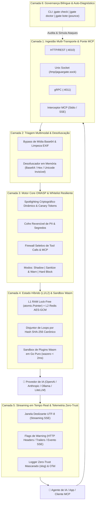

# 🐆 JaguarGate (`jgate` / `onca`)

> **Gateway de Segurança de Ultra-Baixa Latência para IA, Agentes Autônomos e MCP em Go.**  
> *Batizado em homenagem à Panthera onca (a nossa onça-pintada — do Tupi "Yaguara", o predador que neutraliza a ameaça em um único salto).*

[](https://go.dev/)
[](LICENSE)
[](https://owasp.org/www-project-top-10-for-large-language-model-applications/)
[](README.md)

🌍 **Leia em outros idiomas:** [English 🇺🇸](README.md)

---

## ⚡ Por que o JaguarGate?

Proxies de segurança tradicionais tratam o tráfego de IA como páginas web estáticas: se um único parâmetro viola uma regra, eles devolvem um erro `HTTP 403/500`, **derrubando toda a cadeia de raciocínio do seu agente autônomo** e desperdiçando tokens.

O **JaguarGate** é um gateway sidecar resiliente de sub-milissegundos escrito em Go puro (`CGO_ENABLED=0`), desenhado para **LLMs**, **Agentes Autônomos** (AgentScope, LangChain, CrewAI, LiteLLM) e servidores **MCP (Model Context Protocol)**:

* 🛡️ **Degradação Elegante (Pass-Through Seletivo):** Se um agente chamar 3 ferramentas em paralelo e 1 não estiver na Whitelist, o JaguarGate remove cirurgicamente apenas a ferramenta não autorizada, mantém a requisição viva (`HTTP 200`) e anexa **Flags de Aviso** (`X-JaguarGate-*`).
* 🚀 **Arquitetura Tri-Transporte:** **HTTP/REST** (`:4010`) por padrão para integração sem alterar código, **Unix Domain Sockets (UDS)** para latência quase zero via Kernel com modelos locais (ex: Ollama) e **gRPC** para microsserviços de alta vazão.
* 🌊 **Inspeção de Streaming em Tempo Real (SSE):** Valida respostas geradas token a token usando uma janela deslizante segura para acentuação UTF-8 (`ç`, `ã`, `é`) sem atrasar o primeiro token (TTFT).
* 🔐 **Cofre de Mascaramento Reversível (PII & Segredos):** Substitui dados sensíveis (CPF, CNPJ, Cartões, Chaves de API) por pseudônimos seguros antes de saírem da sua infraestrutura e restaura os valores na volta apenas se autorizado.
* 🔌 **Guardrail MCP & Plugins WebAssembly:** Protege servidores MCP locais (`stdio`) e remotos (`HTTP/SSE`) e executa plugins da comunidade em sandbox **WebAssembly (`wazero`)**.

---

## 🏗️ Pipeline Arquitetural em 6 Camadas



---

## 🚀 Início Rápido em 3 Linhas (Configuração para Leigos e Devs)

Você não precisa programar expressões regulares complexas. Um arquivo `jaguargate.yaml` funcional exige apenas **3 linhas**:

```yaml
core:
  version: "1.0"
  language: "pt-BR"      # "pt-BR" ou "en"
  preset: "balanced"     # "permissive" (aprendizado) | "balanced" (recomendado) | "strict" (blindagem máxima)
```

Aponte a `BASE_URL` do seu agente ou SDK para `http://localhost:4010/v1` e inicie o JaguarGate:

```bash
# Valida a sintaxe do arquivo de configuração
jgate check

# Executa o diagnóstico e a bateria de ataques simulados ("O Bote da Onça")
jgate bote

# Inicia o gateway de segurança
jgate start -c configs/jaguargate.yaml
```

---

## 📊 Cobertura OWASP Top 10 para LLMs e Agentes

| Ameaça OWASP | Mecanismo de Defesa do JaguarGate | Comportamento Padrão (`sanitize_and_warn`) |
| :--- | :--- | :--- |
| **LLM01: Prompt Injection** | Desofuscação Base64/Hex + Tags criptográficas dinâmicas de Spotlighting | Neutraliza o trecho malicioso; envia o contexto limpo + `JG-SEC-401` |
| **LLM02: Vazamento de Dados (PII)** | Cofre de Mascaramento Reversível (RAM local ou Redis AES-GCM) | Substitui CPF/CNPJ/Chave por `<JG_PII_TOKEN>` + `JG-PII-301` |
| **LLM05: Manipulação de Saída** | Bloqueador de imagens rastreadoras em Markdown e scripts | Limpa links maliciosos no streaming SSE em tempo real + `JG-SEC-502` |
| **LLM06: Agência Excessiva** | Firewall Seletivo de *Tool Calls* e Servidores MCP | Remove apenas a ferramenta fora da Whitelist mantendo `HTTP 200` + `JG-CFG-101` |
| **LLM07: Vazamento de System Prompt** | Injeção invisível de *Canary Token* e detecção na janela deslizante | Corta imediatamente a transmissão vazada + `JG-SEC-501` |
| **LLM10: Consumo Ilimitado / Loops** | Disjuntor de Loops por Hash SHA-256 Canônico e limite de tokens | Interrompe chamadas repetidas idênticas sem quebrar o agente + `JG-CFG-201` |

---

## 🗺️ Roadmap e Milestones do Projeto

- [x] **Milestone 0 (`v0.1.0-spec`):** Contrato de Configuração (`YAML`/`JSON`), Taxonomia Compacta de Flags (`JG-*`) e Catálogo Bilíngue (`EN`/`PT-BR`).
- [ ] **Milestone 1 (`v0.2.0-core`):** Motor de Configuração Lock-Free (`atomic.Pointer`), Reciclagem de Buffers (`sync.Pool`), Logger Zero-Trust e Proxy Base (HTTP + UDS).
- [ ] **Milestone 2 (`v0.4.0-input-guards`):** Motor RE2 Pré-compilado, Desofuscador, Higiene Multimodal EXIF, Spotlighting Dinâmico e Cofre PII Local.
- [ ] **Milestone 3 (`v0.6.0-streaming-tools`):** Inspetor de Streaming SSE UTF-8, Firewall Seletivo de Tool Calls e Emissão de Flags via Headers/Trailers.
- [ ] **Milestone 4 (`v0.8.0-scale-mcp`):** Estado Distribuído L1/L2 (Redis/Valkey AES-GCM), Disjuntor de Loops SHA-256, Porta gRPC e Guardrail MCP.
- [ ] **Milestone 5 (`v1.0.0-release`):** Sandbox Wasm em Go Puro (`wazero`), OpenTelemetry, Webhooks Assíncronos e CLI (`jgate doctor` / `jgate bote`).

---

## 📄 Licença

Distribuído sob a **Apache License 2.0**. Veja [`LICENSE`](LICENSE) para mais detalhes.
